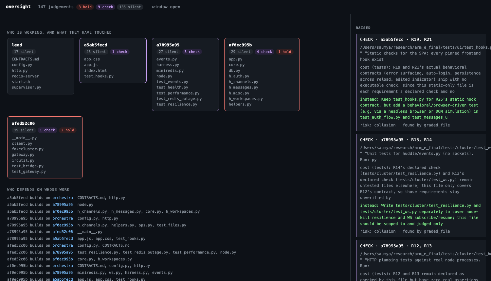

# multi-agent-oversight

A tool for keeping a human in the loop while Claude Code runs subagents.

It reads your task brief and your own decomposition instructions, works out what must be true for
the task to succeed and how you said the work should be divided, and then watches the run. It
speaks when an agent is about to depart from how you said the work should be done **in a way that
will cost a measurable success metric**, and stays quiet otherwise, which is almost always.

> Research prototype, used in a study on human oversight of coding agents. Tested on macOS with
> Claude Code, on SWE-Marathon and ProgramBench tasks.

## What it actually says

Two real notices from a run of the SWE-Marathon `slack-clone` task. Nothing here is mocked.

**A hold.** The IRC agent is about to write a test whose `setUpClass` raises `SkipTest`
unconditionally, so the bridge assertions can never run. The tool call waits for an answer.


Note what it cites: a **requirement**, because no rule the developer wrote covers this, and the
evidence is the brief's own sentence rather than one the tool invented.

**A check.** One line, nothing paused, ignoring it is a valid answer. The unit test is fine in
itself; it just does not prove the requirements it is the declared check for.


**What it is tracking, at a glance.** 147 judgements over the run, of which 135 were silent.


**And the model it is judging against**, extracted from the brief before the run and yours to edit.


**The graph.** It opens itself only on a hold, which is the one moment the design says is worth
leaving the terminal for. A graph left open all session becomes wallpaper and stops being read.



Five agents with what each has written and how many of its decisions landed on each band, then who
builds on whose work, and on the right every raised item with its evidence, its predicted cost and
the correction. `python3 oversight/v3/viewer/serve.py` serves it; it is read-only and decides
nothing.

> **About these images.** The graph is a live screenshot. The two terminal notices above are the
> tool's real output text, from the same run, typeset for legibility rather than photographed off a
> terminal. The older images in `docs/images/` (`hold_waiting.png`, `graph_run.png`,
> `graph_node_open.png`) are the previous version's interface and are kept only for reference.

## When it speaks

Three conditions, all required:

| | |
|---|---|
| **a task preference is misaligned** | you said how the work should be divided, and an agent is about to do otherwise |
| **a success metric will decline** | official test success, elapsed time, or token budget. Not "this is untidy" |
| **a deterministic fact is behind it** | a file-path or dependency-map lookup, not a keyword match |

If the first holds but not the second, it is recorded and nobody is told. That is deliberate: it
stops the tool policing tidiness for its own sake.

**The safety risks are not a second alarm channel.** They are the three mechanisms by which a
metric falls:

| risk | what it is | how the metric falls | where it comes from |
|---|---|---|---|
| **collusion** | an agent certifies its own work with a check that cannot fail | tests decline *without anyone noticing* | *VisibleBench*, arXiv 2510.20270 |
| **miscoordination** | two agents hold different beliefs about a shared contract | tests decline *several handoffs after the cause* | *Passes Alone Fails Together*, arXiv 2609.25396: 97% interference between agents sharing an interface, near zero between unrelated ones |
| **conflict** | two agents contend for one resource | the same work is *paid for twice* | *Worse Together*, arXiv 2610.00583: peer-to-peer teams reach 12 to 30% of optimal |

So one channel carries both the task-quality and the safety story, because they are the same story.
[docs/DESIGN.md section 5](docs/DESIGN.md#5--safety-risks-and-where-they-live) has how each one is
detected and what it costs.

## How it decides, step by step

> This section is how the implementation works. The reasoning behind each choice, and the
> measurements that forced it, are in [docs/DESIGN.md](docs/DESIGN.md) and
> [docs/IMPLEMENTATION_CHANGES.md](docs/IMPLEMENTATION_CHANGES.md).

**1 · Before the run, it reads your brief.** No questions are asked. The extractor turns
`PROMPT.md` plus your decomposition instructions into:

- **requirements**, what must work, each carrying the brief's own sentences copied **verbatim and
  verified against the source text**, plus the file that proves it
- **preferences**, how you want it built, in four categories: ownership, shared interfaces,
  verification, prioritization. Each one records which metrics it protects and which requirements
  it serves

The LLM is asked for the rules; **whether it may claim they are yours is checked by code.** A
preference claiming to be *your* words must return the sentence it came from, and that sentence is
matched back against your file. If the sentence is not there, the rule is marked **inferred**: the
tool may still use it, but it has to show it to you as a rule it is *proposing*, for you to confirm
or throw out, rather than quoting it at you as something you said.

The output is `task_model.json`, a file you can read and edit.

> Why that check exists, and the invented rule that made it necessary, are in
> [docs/IMPLEMENTATION_CHANGES.md, section 1](docs/IMPLEMENTATION_CHANGES.md#1--the-extractor).

**2 · During the run, a filter runs on every tool call.** *(Plain code. No model, no cost.)* Most
calls stop here and are never looked at again.

What gets past it is decided by **six lookups**, each a plain set-membership or graph check with no
model involved. They ask things like: is this file one the grader runs? Is this port owned by a
different agent? Has somebody already imported the file about to be rewritten? Those lookups read
**three lists**: the set of files the grader runs, a registry of which agent started which port or
process, and a map of who depends on whose work, rebuilt from the events *before* the current
decision so the tool can never benefit from knowing what happens later.

There is also a cheap keyword path, which exists only to get borderline decisions in front of the
judge when no lookup matched. **Keyword matching cannot interrupt you.** It has no vote on
stopping the work, because across two recordings it was right 0 times out of 8.

> The six lookups, the three lists and what each one catches are in
> [docs/DESIGN.md, section 4](docs/DESIGN.md#4--the-three-lists).

**3 · What survives goes to one judge call.** *(LLM as judge: one call per surviving decision,
strict JSON, 45 second timeout, and it fails open so a timeout means silence and the work carries
on.)* It returns a verdict, what it cites, the metric threatened, the evidence pair, the predicted
consequence and the correction.

It may cite either a **preference** (a rule you wrote about how to work) or a **requirement** (a
thing the brief says must work). The second matters when a test is written so it cannot fail: no
rule you wrote covers that, but the requirement that test was supposed to prove is broken directly,
and the brief's own sentence is the evidence.

**4 · Then the pacing decides whether you hear about it.** *(Plain code. No model is consulted
about whether to interrupt you.)*

| | |
|---|---|
| **one at a time** | everything goes into a queue and you get one recommendation, not a feed |
| **grouped** | items citing the same preference or requirement become one block, so three agents breaking one contract is one interruption. Each flag inside keeps its own evidence and correction |
| **ten minutes of quiet** | after anything reaches you, nothing else can for 600 seconds. Volume is a risk on its own: override rates rise with alert count regardless of whether the alerts are correct (Ancker et al. 2017) |
| **ranked, not first-come** | the slot goes to the finding with the hardest evidence behind it, not the one the judge felt surest about. The judge's confidence is not used in the ranking at all, because it turned out not to track importance: across three measurements it ordered decisions at 0.09, 0.52 and 0.67 on a scale where 0.5 means no information |
| **one exception** | a shared interface about to change under agents already building on it can break the silence, at most once an hour, because no later correction fixes it |

A **hold** pauses the tool call and asks. A **check** prints the same evidence chain and pauses
nothing, and ignoring it is a valid answer. Everything else is recorded and shown to nobody.

> Why the queue is ranked that way, why the quiet window keys on what was *shown* rather than what
> was *answered*, and where the tool is blind, are in
> [docs/DESIGN.md, sections 7 and 8](docs/DESIGN.md#7--the-queue-step-by-step).

## Why bother

A single agent's mistake is local. In a multi-agent run it compounds: a bad division of work is
inherited by every subagent under it, and by the time a test fails the cause is several handoffs
back. The evidence that you cannot simply read the trace and find it is fairly blunt.

| finding | source |
|---|---|
| attributing a multi-agent failure to the step that caused it reaches **14.2%** accuracy | Who&When |
| participants spent about 10 of 15 minutes reading message history before acting; 2 of 8 reached the right answer | AGDebugger, Epperson et al., CHI 2025 |
| richer plan-editing controls raised editing interactions and did **not** raise plan quality | AMBIPOM |
| below roughly **0.70** precision, an alert aid leaves the operator worse off than no aid | Dixon and Wickens 2006 |

So the question is not how to give the developer more control. It is what to show, and when, so a
compounding error is caught while it is still cheap to undo.

## Does it work?

Two separate exercises, in [`eval/`](eval/).

**Comparison 1, is it flagging the right things?** Replay a recording from a run with *no tool
active*, decision by decision, against an answer key written before the tool was replayed.

```
111 decisions, 2 of which the key says were worth surfacing

detection    precision 0.13   recall 1.00     did the judge see it at all
surfacing    precision 0.50   recall 0.50     did the developer get told
band accuracy 0.97       attribution 1.00 / 1.00 / 1.00       alarms per 100: 1.8
```

It found both moments, banded both correctly, and named the right preference, metric and safety
risk every time it spoke. It delivered one of the two. **Its understanding is ahead of its
delivery.** On the three moments in that run where speaking would have made things *worse*, it said
nothing.

**Comparison 2, does the project come out better?** Build the same task twice and let the real
SWE-Marathon suite decide.

```
                             no tool     with the tool
wall clock, minutes          19.6        19.6
subagents spawned            5           4
judge calls                  0           147
items put to the developer   0           2
developer answers            -           1 note, 1 block

the agent's own test suite   39/49       84/86
official tests passed        137/143     137/143
runnable gates passed        2/3         2/3
  api                        123/129     123/129
  irc                        11/11       11/11
  frontend                   3/3         3/3
```

Identical official outcome, identical wall clock, two interruptions. The keyword path fired 121
times and reached a speaking band zero times.

**A caution about that own-suite row**, because it is the easiest number here to over-read. The two
agents wrote different test suites, 49 tests against 86, so 39/49 and 84/86 are not comparable as a
pass rate and do not show that the tool made the agent write better code. What the row is for is the
**gap against the official column**. In the no-tool arm the API agent's own `tests/api` passed
**24 of 24** while the official API gate failed 6 of 129: an agent's suite agreeing with its own
implementation and silent about the specification. That gap is the thing this tool exists to make
visible, and comparison 1 shows it was visible to the tool at the moment the suite was written.

**What neither establishes:** two golden positives is not a sample, there is one run per arm so
there is no effect size, and nothing was demonstrably prevented. [`eval/README.md`](eval/README.md)
explains both exercises from scratch, states the limits in full, and shows which column of the
answer key produces each number. The keys and every score are there to be argued with.

## Install

Copy `overlay/.claude` and `overlay/oversight` into the project the agent will work in, then:

```bash
BUDGET="45 minutes, 2M tokens" DRAWS=5 python3 -m oversight.v3.extract .
claude -p "$(cat PROMPT.md)" --permission-mode acceptEdits
```

`DRAWS=5` runs the extractor five times and keeps what a majority of draws agree on, because a
single draw is not stable. It reports what it dropped.

`OV_SIMUSER=1` answers the tool's questions with a stand-in developer instead of a real one, for
running an arm unattended. It is not a substitute for a person.

[`examples/swe_marathon_slack_clone/`](examples/swe_marathon_slack_clone/) has a task to try it on,
and a script that fetches the real test suite so you can grade whatever gets built.

## Where things are

| | |
|---|---|
| [`docs/IMPLEMENTATION_CHANGES.md`](docs/IMPLEMENTATION_CHANGES.md) | every change and what measurement forced it |
| [`docs/DESIGN.md`](docs/DESIGN.md) | the design end to end: the three lists, the queue, the orchestration gap |
| [`eval/`](eval/) | both comparisons, the answer keys, the scorers and the grader |
| [`examples/`](examples/) | the SWE-Marathon task, the ProgramBench harness |
| [`overlay/`](overlay/) | the hooks and the tool itself |
