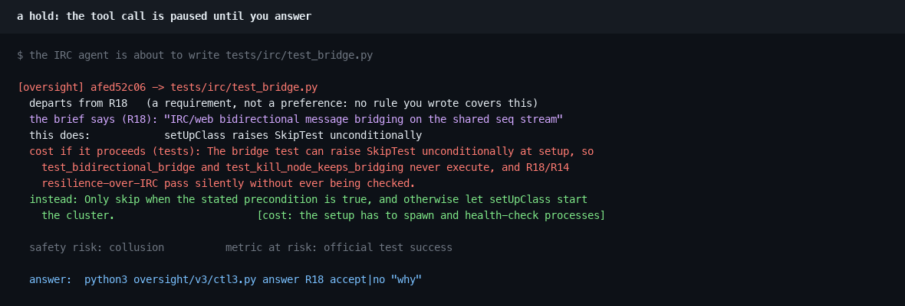
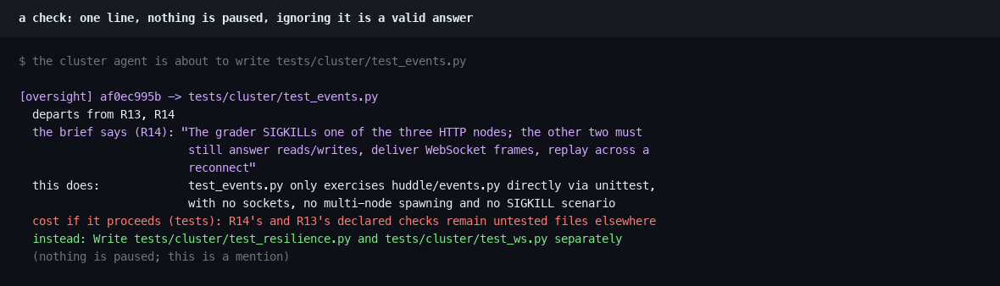
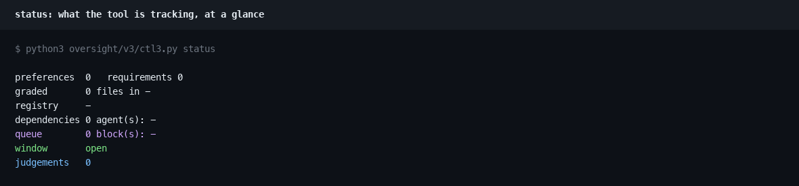
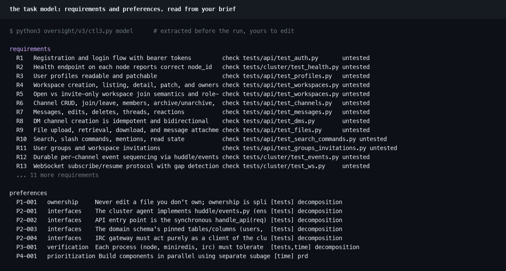

# multi-agent-oversight

A tool for keeping a human in the loop while Claude Code runs subagents.

It reads your task brief and your own decomposition instructions, works out what must be true for
the task to succeed and how you said the work should be divided, and then watches the run. It
speaks when an agent is about to depart from how you said the work should be done **in a way that
will cost a measurable success metric** — and stays quiet otherwise, which is almost always.

> Research prototype, used in a study on human oversight of coding agents. Tested on macOS with
> Claude Code, on SWE-Marathon and ProgramBench tasks.

## What it actually says

Two real notices from a run of the SWE-Marathon `slack-clone` task. Nothing here is mocked.

**A hold.** The IRC agent is about to write a test whose `setUpClass` raises `SkipTest`
unconditionally, so the bridge assertions can never run. The tool call waits for an answer.



Note what it cites: a **requirement**, because no rule the developer wrote covers this, and the
evidence is the brief's own sentence rather than one the tool invented.

**A check.** One line, nothing paused, ignoring it is a valid answer. The unit test is fine in
itself; it just does not prove the requirements it is the declared check for.



**What it is tracking, at a glance.** 147 judgements over the run, of which 135 were silent.



**And the model it is judging against**, extracted from the brief before the run and yours to edit.



> The older images in `docs/images/` (`hold_waiting.png`, `graph_run.png`, `graph_node_open.png`)
> show the previous version's five-question init and catch-up counter, neither of which exists.

## When it speaks

Three conditions, all required:

| | |
|---|---|
| **a task preference is misaligned** | you said how the work should be divided, and an agent is about to do otherwise |
| **a success metric will decline** | official test success, elapsed time, or token budget. Not "this is untidy" |
| **a deterministic fact is behind it** | a file-path or dependency-map lookup, not a keyword match |

If the first holds but not the second, it is recorded and nobody is told. That is deliberate: it
stops the tool policing tidiness for its own sake.

**The safety risks are not a second alarm channel.** They are the three mechanisms by which a
metric falls:

| risk | what it is | how the metric falls |
|---|---|---|
| **collusion** | an agent certifies its own work with a check that cannot fail | tests decline *without anyone noticing* |
| **miscoordination** | two agents hold different beliefs about a shared contract | tests decline *several handoffs after the cause* |
| **conflict** | two agents contend for one resource | the same work is *paid for twice* |

So one channel carries both the task-quality and the safety story, because they are the same story.

## How it decides

**1 · Before the run, it reads your brief.** No questions are asked. The extractor turns
`PROMPT.md` plus your decomposition instructions into:

- **requirements** — what must work, each carrying the brief's own sentences copied **verbatim and
  verified against the source text**, plus the file that proves it
- **preferences** — how you want it built, in four categories: ownership, shared interfaces,
  verification, prioritization. Each one records which metrics it protects and which requirements
  it serves

A preference claiming to be *your* words must return the sentence it came from, and that sentence is
matched back against your file. If it is not there, the rule is marked **inferred** and has to be
proposed for confirmation rather than quoted at you as yours.

The output is `task_model.json`, a file you can read and edit.

**2 · During the run, a filter runs on every tool call.** Six deterministic lookups against three
lists — the graded file set, a port and process registry, and a dependency map rebuilt from events
*before* the current decision — plus a cheap keyword path that exists only to get borderline
decisions in front of the judge. **Keyword matching cannot interrupt you**; it has no vote.

**3 · What survives goes to one judge call.** It returns a verdict, what it cites, the metric
threatened, an evidence pair, the predicted consequence and the correction. It may cite a
preference **or** a requirement: a declared check that cannot do its job breaks the requirement
directly, which needs no invented rule.

**4 · Then the pacing decides whether you hear about it.**

| | |
|---|---|
| **one at a time** | everything goes into a queue and you get one recommendation, not a feed |
| **grouped** | items citing the same preference or requirement become one block, so three agents breaking one contract is one interruption. Each flag inside keeps its own evidence and correction |
| **ten minutes of quiet** | after anything reaches you, nothing else can for 600 seconds |
| **ranked, not first-come** | the slot goes to the most deterministic finding, not the most confident one. Confidence is not in the ranking at all: measured at AUC 0.09, 0.52 and 0.67 across three runs, where 0.5 is no information |
| **one exception** | a shared interface about to change under agents already building on it can break the silence, at most once an hour, because no later correction fixes it |

A **hold** pauses the tool call and asks. A **check** prints the same evidence chain and pauses
nothing. Everything else is recorded and shown to nobody.

## Does it work?

Two separate exercises, in [`eval/`](eval/).

**Comparison 1 — is it flagging the right things?** Replay a recording from a run with *no tool
active*, decision by decision, against an answer key written before the tool was replayed.

```
111 decisions, 2 of which the key says were worth surfacing

detection    precision 0.13   recall 1.00     did the judge see it at all
surfacing    precision 0.50   recall 0.50     did the developer get told
band accuracy 0.97       attribution 1.00 / 1.00 / 1.00       alarms per 100: 1.8
```

It found both moments, banded both correctly, and named the right preference, metric and safety
risk every time it spoke. It delivered one of the two. **Its understanding is ahead of its
delivery.** On the three moments in that run where speaking would have made things *worse*, it said
nothing.

**Comparison 2 — does the project come out better?** Build the same task twice and let the real
SWE-Marathon suite decide.

```
                             no tool     with the tool
wall clock, minutes          19.6        19.6
judge calls                  0           147
items put to the developer   0           2
official tests passed        137/143     137/143
```

Identical outcome, identical wall clock, two interruptions. The keyword path fired 121 times and
reached a speaking band zero times.

**What neither establishes:** two golden positives is not a sample, comparison 1 did not replicate
on a second recording, there is one run per arm so there is no effect size, and nothing was
demonstrably prevented. [`eval/README.md`](eval/README.md) states the limits in full, and the
answer keys and every score are there to be argued with.

## Install

Copy `overlay/.claude` and `overlay/oversight` into the project the agent will work in, then:

```bash
BUDGET="45 minutes, 2M tokens" DRAWS=5 python3 -m oversight.v3.extract .
claude -p "$(cat PROMPT.md)" --permission-mode acceptEdits
```

`DRAWS=5` runs the extractor five times and keeps what a majority of draws agree on, because a
single draw is not stable. It reports what it dropped.

`OV_SIMUSER=1` answers the tool's questions with a stand-in developer instead of a real one, for
running an arm unattended. It is not a substitute for a person.

[`examples/swe_marathon_slack_clone/`](examples/swe_marathon_slack_clone/) has a task to try it on,
and a script that fetches the real test suite so you can grade whatever gets built.

## Where things are

| | |
|---|---|
| [`docs/IMPLEMENTATION_CHANGES.md`](docs/IMPLEMENTATION_CHANGES.md) | every change and what measurement forced it |
| [`docs/DESIGN.md`](docs/DESIGN.md) | the design end to end: the three lists, the queue, the orchestration gap |
| [`eval/`](eval/) | both comparisons, the answer keys, the scorers and the grader |
| [`examples/`](examples/) | the SWE-Marathon task, the ProgramBench harness |
| [`overlay/`](overlay/) | the hooks and the tool itself |
